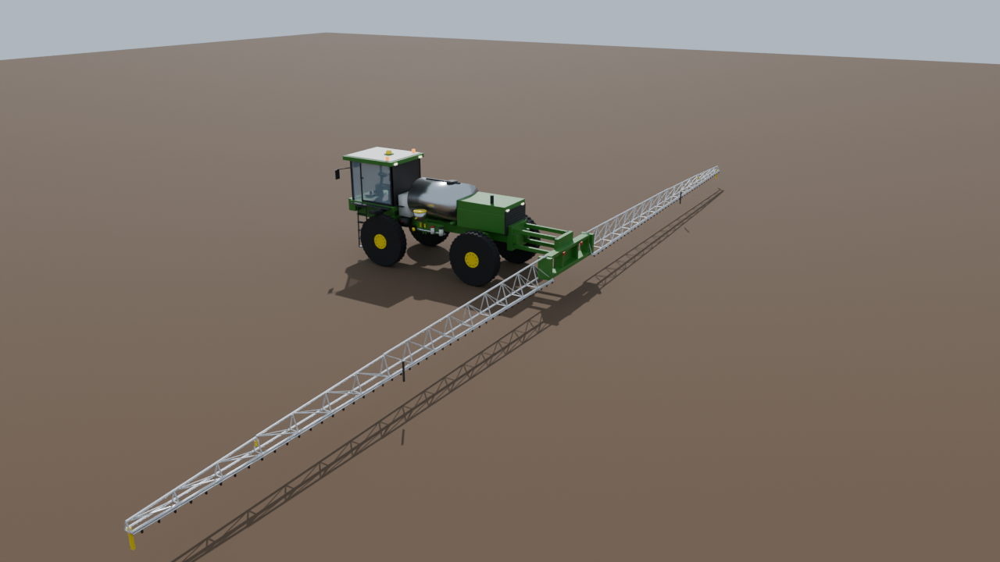
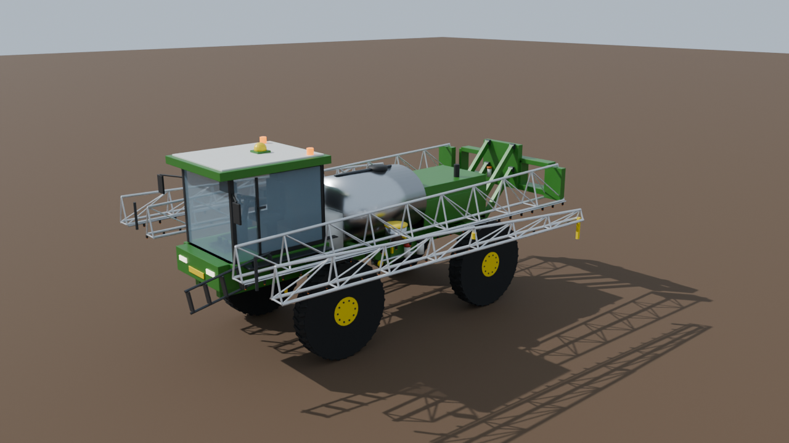
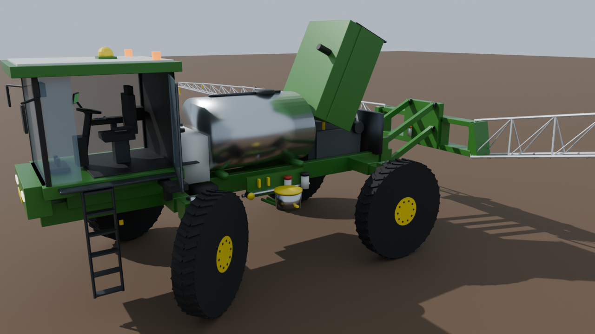
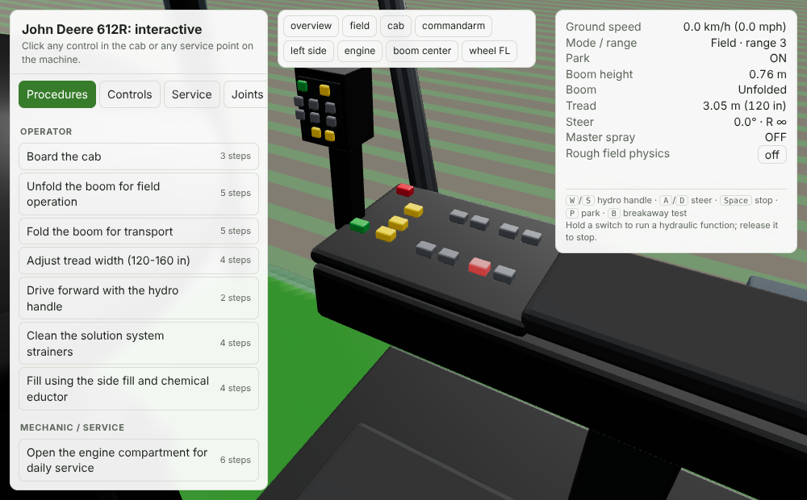
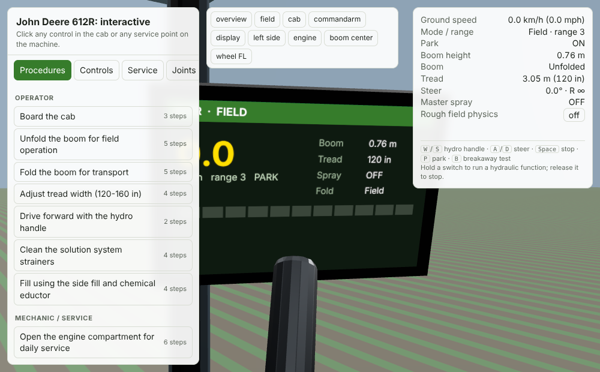

# John Deere 612R: interactive 3D sprayer for a manual-driven RAG

A procedurally generated Blender model of the **John Deere 612R self-propelled sprayer** with an articulated pivot hierarchy, plus a browser viewer that a RAG assistant can drive. When an answer from the operator's manual says "press boom fold IN" or "check the 80-mesh boom strainer", the assistant can show that control or part on the machine and run it.





| Interactive viewer: CommandARM (highlighted switch) | Live CommandCenter display |
|---|---|
|  |  |

## What is in the repo

| Path | What it is |
|---|---|
| `spec/612r_spec.json` | **Single source of truth.** Specs (each tagged OFFICIAL / DERIVED / ESTIMATE, with sources), joints, controls, service points, interlocks, camera views, procedures. |
| `blender/build_612r.py` | Builds the model from the spec. Writes `build/john_deere_612r.blend` (posable with drivers) and `build/john_deere_612r.glb`. |
| `viewer/` | three.js viewer (three r160 vendored, works offline). Clickable controls, hydraulic rate limits, interlocks, vehicle kinematics, suspension and boom dynamics, guided procedures, and an API for the RAG. |
| `tools/export_rag_index.py` | Writes `build/rag_index.jsonl`: embeddable text for each control, service point, procedure, joint and spec, each with the viewer payload that shows it. |
| `rag/show_on_sprayer.tool.json` | Tool definition so an LLM can drive the viewer from its answers. |

## Quick start

```bash
pip install bpy                                  # or use a Blender 4.x/5.x install
python3 blender/build_612r.py --out build        # about 3 s; add --render for docs/*.png (Cycles, about 2 min)
python3 tools/export_rag_index.py
python3 -m http.server 8000                      # from the repo root
# open http://localhost:8000/viewer/
```

In Blender, open `build/john_deere_612r.blend`, select **SPRAYER_612R**, open *Object Properties → Custom Properties*, and drag `boom_height`, `fold_L`, `tread`, `steer` and the other values. Drivers move the pivots with the correct kinematics. Turn on *Auto Run Python Scripts*, because the drivers use expressions.

## What "physically intact" means here

- **Real dimensions where Deere publishes them.** Wheelbase 4.30 m, tread 3.05–4.06 m, crop clearance 1.47 m, 380/105R50 tires (Ø 2.07 m), 1,200 gal tank, 646 L rinse tank, 120 ft / 11-section boom with 15 in nozzle spacing (96 nozzles modelled), boom height 0.50–2.45 m, turning radius 9.2 m.
- **Kinematics, not keyframes.**
  - Ackermann front steering derived from the 9.2 m turning radius: 27.9° outer, about 40° inner.
  - Parallel-link boom lift: the centre frame stays level through the whole 0.5–2.45 m range.
  - Fold chain: main fold, then outer fold, then spring breakaway.
  - Telescoping tread legs, air-ride struts, a parallel-link eductor that keeps the hopper level, hood, ladder and door hinges.
- **Physical interlocks the geometry enforces.**
  - The main wings can't fold below 2.1 m because they would hit the tires.
  - The outer wings must fold before the main wings.
  - Tread adjust only moves while the machine rolls at 0.3–8 km/h.
- **Dynamics.**
  - Hydrostatic drive: the hydro handle commands speed with acceleration limits.
  - Each wheel rolls at its own turn radius.
  - Spring-damper heave, pitch and roll over a rough-field heightfield.
  - Boom wings sway and bounce when unfolded. BoomTrac damps the bounce.
  - Breakaway tips spring back after a hit (key `B`).

## Accuracy: read before you use this for training

The published spec sheet doesn't cover everything a manual-based assistant needs. Anything not on it is **marked `ESTIMATE` or `"verified": false`** in `spec/612r_spec.json`, and the viewer shows a **verify** tag on those controls. In particular:

- **The CommandARM and hydro-handle button layout is a placeholder.** The control *functions* are real 612R functions; the *positions, shapes and grouping* are not. Fix them against the operator's manual for your serial-number range.
- Overall height and transport width, the boom section split (only the 3.3 m breakaway is official), and the positions of service points (filters, strainers, reservoir, batteries).
- Pivot travel angles and hydraulic speeds.
- The non-physical interlocks: ladder up before driving, Road mode only with the boom folded, spray only with the boom unfolded. These are plausible but not confirmed.

To correct something, edit `spec/612r_spec.json` or the matching block in `build_612r.py`, rebuild, and set `"verified": true`.

## Hooking it to your RAG

1. Embed `build/rag_index.jsonl` next to your manual chunks, or give the LLM `rag/show_on_sprayer.tool.json`.
2. Put the viewer in an iframe beside the chat.
3. When an answer involves something physical, send the matching payload:

```js
const v = document.querySelector("iframe#sprayer").contentWindow;
v.postMessage({ type: "612r", cmd: "procedure", id: "op_fold_boom" }, "*");          // guided steps
v.postMessage({ type: "612r", cmd: "press", control: "ca_fold_L_in", ms: 3000 }, "*"); // hold a switch
v.postMessage({ type: "612r", cmd: "highlight", meshes: ["SVC_boom_strainer"], camera: "boom_center" }, "*");
v.postMessage({ type: "612r", cmd: "set", joints: { boom_height: 2.4, tread: 3.81 } }, "*");
```

Deep links work as well: `viewer/?procedure=mx_engine_access&step=2`, `viewer/?control=ca_tread_wider`, `viewer/?camera=commandarm&highlight=BTN_park`, `viewer/?set=boom_height:2.4,fold_L:90`.

To add a manual procedure, append it to `procedures` in the spec. Each step can set `camera`, `highlight`, joint targets (`set`) and machine `state`. Then re-run `tools/export_rag_index.py`.

## Sources

- [John Deere 612R product page](https://www.deere.com/en/sprayers/400-600-series/612r-sprayer)
- [John Deere Canada 612R spec table](https://www.deere.ca/en/sprayers/400-600-series/612r-sprayer/)
- [Sloan Implement 612R spec sheet (dealer copy of the Deere specs)](https://www.sloans.com/catalog/new-john-deere-ag/sprayers-and-application-equipment/sprayer-chassis/612r-sprayer)

This project is not affiliated with or endorsed by Deere & Company. The model is a simplified engineering approximation for training and illustration.
